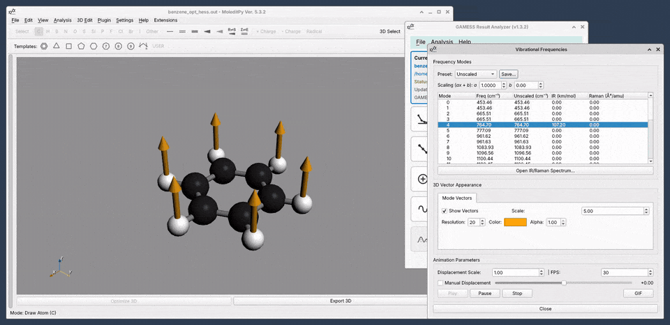
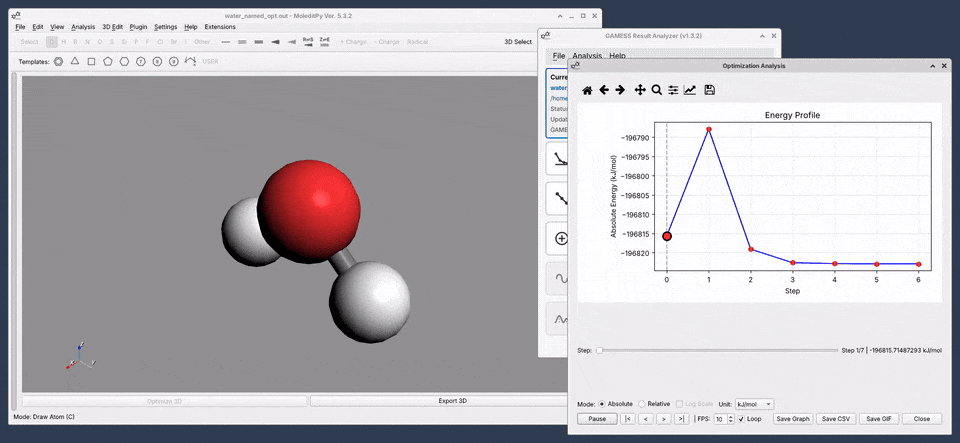
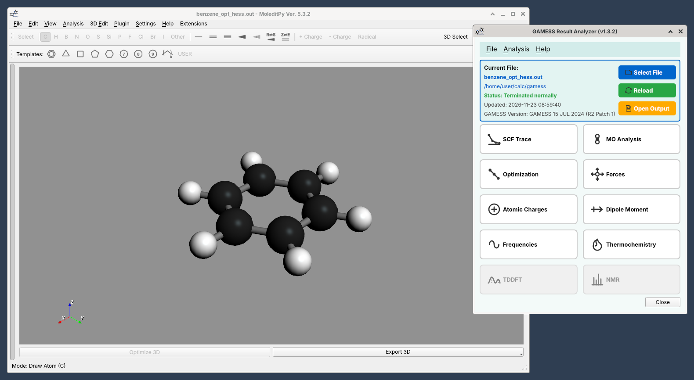
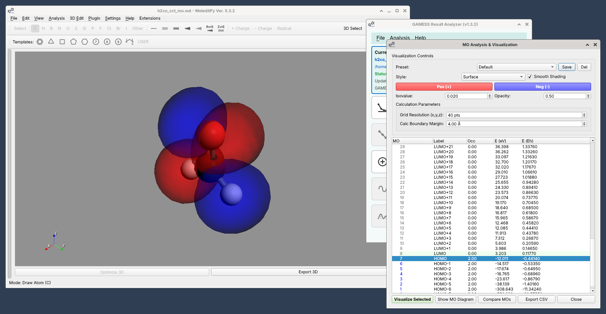
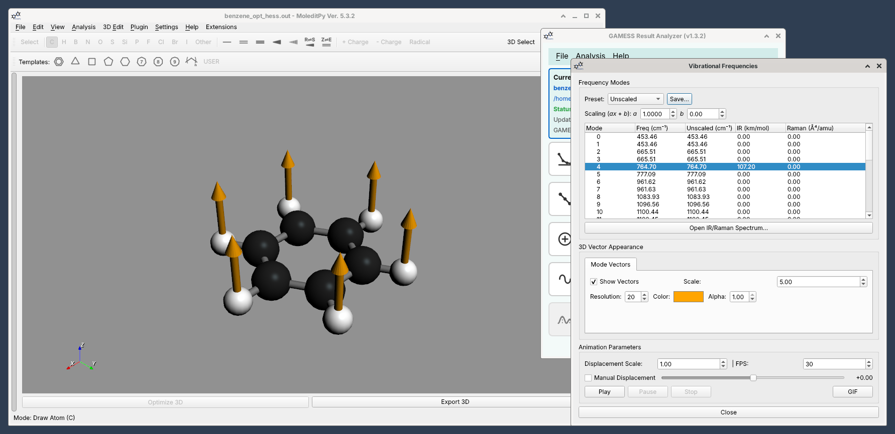
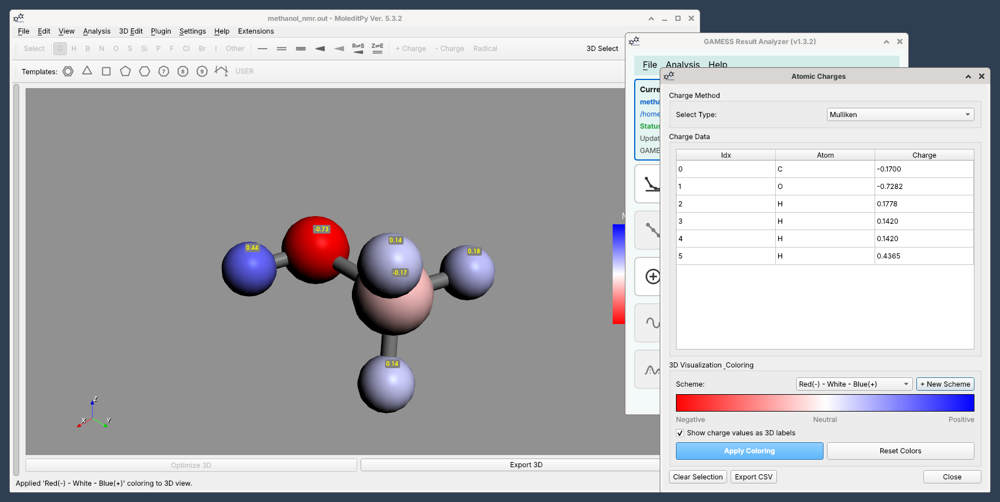
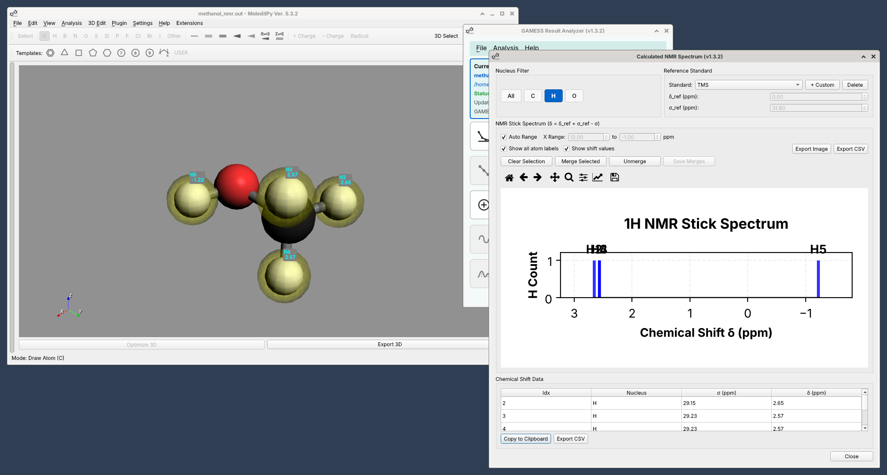
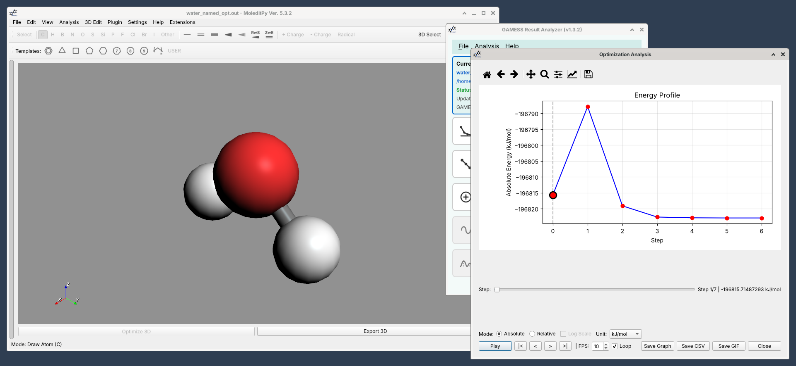
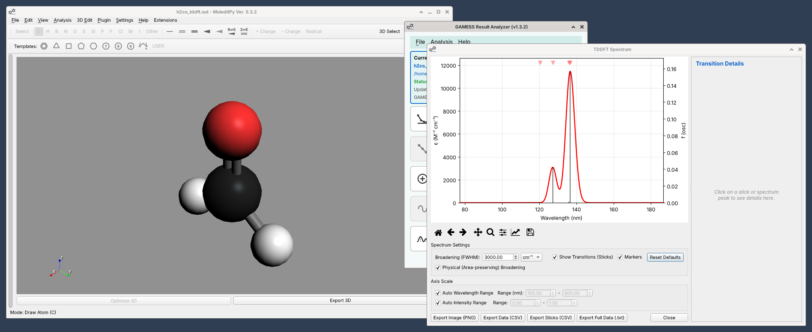

# MoleditPy GAMESS Result Analyzer Plugin

[](https://doi.org/10.5281/zenodo.24040540)
[](https://github.com/HiroYokoyama/python_molecular_editor)
[](https://github.com/sponsors/HiroYokoyama)
[](https://github.com/HiroYokoyama/moleditpy_gamess_result_analyzer/tags)
[](https://github.com/HiroYokoyama/moleditpy_gamess_result_analyzer/releases)

A plugin for MoleditPy that reads GAMESS (US) output (`.log`, `.out`) and presents it
as analysis windows: orbitals, vibrational modes, spectra, charges and optimization
paths. The parsers and the orbital engine are written and checked against real
output from GAMESS 2024 R2.

This plugin is an independent project and is not affiliated with or endorsed by the
Gordon Group at Iowa State University. You need your own copy of GAMESS to produce
the files it reads.

## Screenshots

The analyzer works beside the MoleditPy window rather than inside a viewer of its
own. Pick an orbital, a normal mode or an optimization step, and MoleditPy's 3D view
follows: orbitals as isosurfaces, modes as arrows and animation, steps as geometries.


| Normal mode animation | Optimization playback |
|---|---|
|  |  |

**Main window**: one button per analysis, enabled when the output holds the data.



| Molecular orbitals | Frequencies |
|---|---|
|  |  |

| Atomic charges | NMR |
|---|---|
|  |  |

| Optimization | TD-DFT |
|---|---|
|  |  |

All taken with MoleditPy 5.3.2 from the jobs in `tests/sample_outputs`.

## Features

- **SCF trace**: energy against iteration for every SCF in the job (RHF, UHF, ROHF).
- **Molecular orbitals**: energy levels with HOMO/LUMO marked, and 3D isosurfaces for
  restricted and unrestricted wavefunctions, with s to g shells. Up to four orbitals
  side by side in **Compare MOs**.
- **Optimization**: energy against step, with animation and GIF export.
- **Forces**: gradients for each geometry.
- **Atomic charges**: Mulliken, Lowdin, and fitted ESP charges from `$ELPOT`/`$PDC`.
- **Dipole moment** as a vector on the structure.
- **Frequencies**: normal modes with IR intensities, and Raman activities from
  `RUNTYP=RAMAN`, animated.
- **Thermochemistry**: ZPE, enthalpy, Gibbs energy and entropy term.
- **TD-DFT**: excited states with simulated absorption spectra.
- **NMR**: GIAO shieldings, with a stick spectrum.
- **Bond analysis**: Mayer bond orders.
- **Post-HF energies**: MP2, SCS-MP2, CCSD and CCSD(T); dispersion corrections.

Opening a file through **File > Open** or by dropping it on the window works for both
`.log` and `.out`. Both extensions are shared with other programs, so the plugin
checks the file's header first; another program's output goes on to whichever plugin
handles it.

## Keywords to request from GAMESS

| Analysis | Input |
|---|---|
| All orbitals in 3D | `$CONTRL NPRINT=7 $END`, and a single-point job |
| Fitted ESP charges | `$ELPOT IEPOT=1 WHERE=PDC OUTPUT=BOTH $END` with `$PDC PTSEL=CHELPG CONSTR=CHARGE $END` |
| Frequencies | `RUNTYP=HESSIAN` |
| Raman | `RUNTYP=RAMAN` with `$HESS` and `$DIPDR` from the Hessian's punch file |
| TD-DFT | `TDDFT=EXCITE` with `DFTTYP` |
| NMR | `RUNTYP=NMR`, on one core; RHF only |
| CCSD and CCSD(T) | `CCTYP=` with `$SYSTEM MEMDDI` above zero |

The **MO** window has a button that copies the orbital keyword to the clipboard.

## Known limitations

These follow from what GAMESS prints, so the plugin offers no control for them:

- No J couplings, so NMR shows sticks without multiplets.
- TD-DFT reports length-gauge oscillator strengths only: no velocity gauge and no CD.
- No NBO tables, unless a linked NBO program writes them, which the plugin does not read.
- No relaxed scan view: GAMESS has no scan keyword.
- After an optimization, GAMESS repeats only the occupied and a few virtual orbitals
  at the final geometry, and those are what the MO window shows. Run a single point
  with `NPRINT=7` to see all of them.

## What each claim is tested with

Every feature above has a real GAMESS job in `tests/sample_outputs`.
`tests/claimed_features.py` lists them. `tests/test_claimed_features.py` checks that
each job enables its button, and `tests/test_real_windows.py` opens each window under
real Qt and presses its buttons. `tests/test_gamess_parser.py` integrates the orbitals
on a real-space grid and requires them to be orthonormal, and compares water at
RHF/6-31G(d) against Gaussian 16.

## Command line

The analyzer also runs without a window, so a
script, a batch job or a remote shell can read an output file directly. No
editor and no Qt window is opened.

```bash
moleditpy -r gamess_result_analyzer parse job.log                 # summary
moleditpy -r gamess_result_analyzer parse job.log --json          # every parsed value, as JSON
moleditpy -r gamess_result_analyzer parse job.log --json -s thermal -s frequencies
moleditpy -r gamess_result_analyzer xyz job.log -o final.xyz      # final structure
moleditpy -r gamess_result_analyzer xyz job.log --all -o path.xyz # every step, one frame each
```

`moleditpy -r` needs MoleditPy 5.3.0 or later. `-r` is short for
`--run-plugin`; `moleditpy --list-plugins` shows the installed
plugins that can be run this way. `python -m` works just as well, from the
folder that contains the `gamess_result_analyzer` folder (your plugins folder, or a checkout of
this repository), with the Python MoleditPy is installed in, and needs no
MoleditPy launcher:

```bash
python -m gamess_result_analyzer parse job.log
```

`FILE` is a GAMESS output file.

| Command | What it does |
|---|---|
| `parse FILE` | Prints a summary: program version, termination, formula, charge and multiplicity, SCF energy, <S**2>, HOMO/LUMO gap, dipole, steps and whether an optimisation converged, frequencies with the number of imaginary modes, Gibbs energy, excited states, NMR, charges and NBO, each only when the file has it. The last line lists the sections present. |
| `parse FILE --json` | Prints the parsed data the analysis windows read, as JSON. `-s NAME` (repeatable) keeps only those top-level sections; `--indent N` sets the indent. |
| `xyz FILE` | Writes the final structure as XYZ in Angstrom, with the SCF energy in the comment line. |
| `xyz FILE --all` | Writes a multi-frame XYZ: the points of a scan or IRC, otherwise every optimisation cycle, each with its energy in the comment line. |

Every command takes `-o PATH` to write a file instead of standard output.
The exit status is 0 on success, 1 when the file cannot be read, is not GAMESS
output or has nothing to write, and 2 for a usage error such as an unknown
section.

## Installation

Install it through the MoleditPy Plugin Installer, or unpack the release zip into
your plugins folder.

## Requirements

- MoleditPy 5.0 or later
- numpy, pyvista, matplotlib, PySide6, rdkit (all provided by MoleditPy)

## License

Licensed under the GNU Lesser General Public License v3.0 or later. See
[LICENSE](LICENSE), [COPYING](COPYING) and [LICENSING.md](LICENSING.md). The software
is provided as is, without warranty; check results independently before relying on them.
