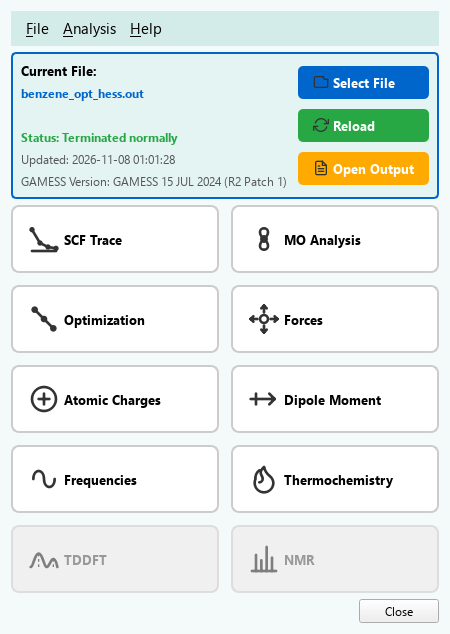
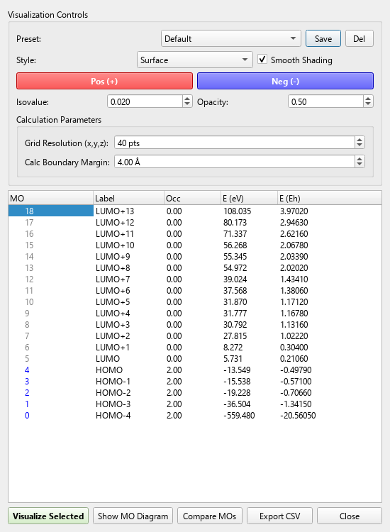
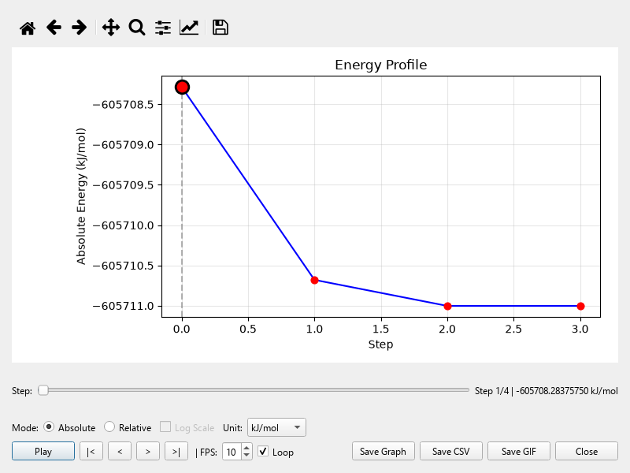
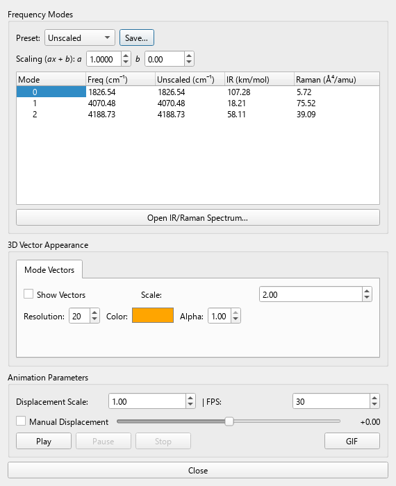
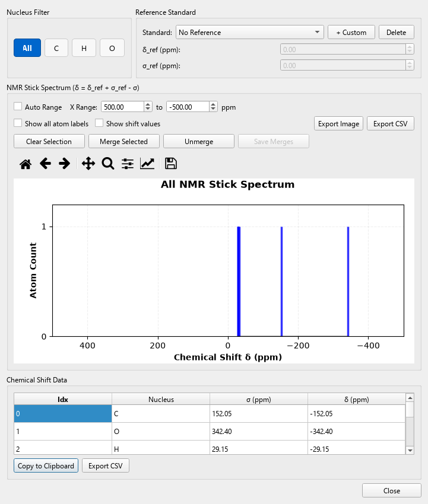
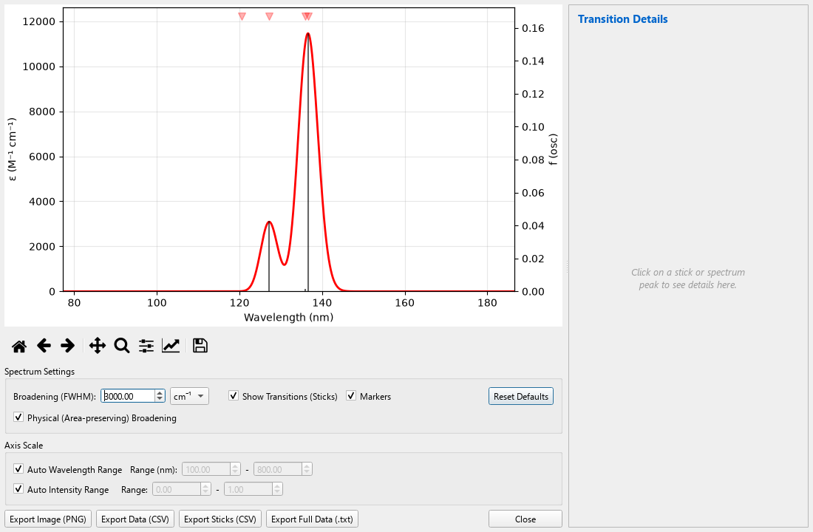

# MoleditPy GAMESS Result Analyzer Plugin

A plugin for MoleditPy that reads GAMESS (US) output (`.log`, `.out`) and presents it
as analysis windows: orbitals, vibrational modes, spectra, charges and optimization
paths. The parsers and the orbital engine are written and checked against real
output from GAMESS 2024 R2.

This plugin is an independent project and is not affiliated with or endorsed by the
Gordon Group at Iowa State University. You need your own copy of GAMESS to produce
the files it reads.

## Screenshots

| Molecular orbitals | Optimization |
|---|---|
|  |  |

| Frequencies | NMR |
|---|---|
|  |  |

All taken from the jobs in `tests/sample_outputs`. The 3D view belongs to the MoleditPy
window, so the isosurfaces and animated modes appear there rather than here.

## Features

- **SCF trace**: energy against iteration for every SCF in the job (RHF, UHF, ROHF).
- **Molecular orbitals**: energy levels with HOMO/LUMO marked, and 3D isosurfaces for
  restricted and unrestricted wavefunctions, with s to g shells. Up to four orbitals
  side by side in **Compare MOs**.
- **Optimization**: energy against step, with animation and GIF export.
- **Forces**: gradients for each geometry.
- **Atomic charges**: Mulliken, Lowdin, and fitted ESP charges from `$ELPOT`/`$PDC`.
- **Dipole moment** as a vector on the structure.
- **Frequencies**: normal modes with IR intensities, and Raman activities from
  `RUNTYP=RAMAN`, animated.
- **Thermochemistry**: ZPE, enthalpy, Gibbs energy and entropy term.
- **TD-DFT**: excited states with simulated absorption spectra.
- **NMR**: GIAO shieldings, with a stick spectrum.
- **Bond analysis**: Mayer bond orders.
- **Post-HF energies**: MP2, SCS-MP2, CCSD and CCSD(T); dispersion corrections.

Opening a file through **File > Open** or by dropping it on the window works for both
`.log` and `.out`. Both extensions are shared with other programs, so the plugin
checks the file's header first; another program's output goes on to whichever plugin
handles it.

## Keywords to request from GAMESS

| Analysis | Input |
|---|---|
| All orbitals in 3D | `$CONTRL NPRINT=7 $END`, and a single-point job |
| Fitted ESP charges | `$ELPOT IEPOT=1 WHERE=PDC OUTPUT=BOTH $END` with `$PDC PTSEL=CHELPG CONSTR=CHARGE $END` |
| Frequencies | `RUNTYP=HESSIAN` |
| Raman | `RUNTYP=RAMAN` with `$HESS` and `$DIPDR` from the Hessian's punch file |
| TD-DFT | `TDDFT=EXCITE` with `DFTTYP` |
| NMR | `RUNTYP=NMR`, on one core; RHF only |
| CCSD and CCSD(T) | `CCTYP=` with `$SYSTEM MEMDDI` above zero |

The **MO** window has a button that copies the orbital keyword to the clipboard.

## Known limitations

These follow from what GAMESS prints, so the plugin offers no control for them:

- No J couplings, so NMR shows sticks without multiplets.
- TD-DFT reports length-gauge oscillator strengths only: no velocity gauge and no CD.
- No NBO tables, unless a linked NBO program writes them, which the plugin does not read.
- No relaxed scan view: GAMESS has no scan keyword.
- After an optimization, GAMESS repeats only the occupied and a few virtual orbitals
  at the final geometry, and those are what the MO window shows. Run a single point
  with `NPRINT=7` to see all of them.

## What each claim is tested with

Every feature above has a real GAMESS job in `tests/sample_outputs`.
`tests/claimed_features.py` lists them. `tests/test_claimed_features.py` checks that
each job enables its button, and `tests/test_real_windows.py` opens each window under
real Qt and presses its buttons. `tests/test_gamess_parser.py` integrates the orbitals
on a real-space grid and requires them to be orthonormal, and compares water at
RHF/6-31G(d) against Gaussian 16.

## Installation

Install it through the MoleditPy Plugin Installer, or unpack the release zip into
your plugins folder.

## Requirements

- MoleditPy 5.0 or later
- numpy, pyvista, matplotlib, PySide6, rdkit (all provided by MoleditPy)

## License

Licensed under the GNU Lesser General Public License v3.0 or later. See
[LICENSE](LICENSE), [COPYING](COPYING) and [LICENSING.md](LICENSING.md). The software
is provided as is, without warranty; check results independently before relying on them.
